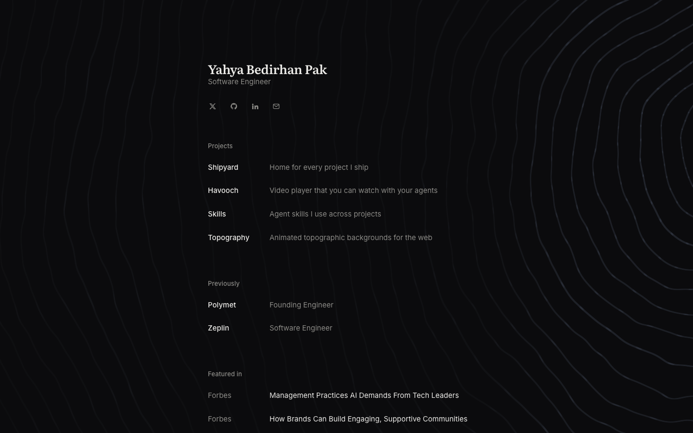

<p align="center"></p>

<h1 align="center">yahyapak.dev</h1>

<p align="center"><strong><a href="https://yahyapak.dev">Visit yahyapak.dev →</a></strong></p>



## What is yahyapak.dev

It's my personal website. I'm Yahya Bedirhan Pak, a software engineer, and this is where I keep who I am, what I build and where I've worked. It lives at [yahyapak.dev](https://yahyapak.dev).

## Stack

- [Astro](https://astro.build) with static output: every page is its own HTML file, built from `src/data.js`
- Astro's client router moves between pages without a full load, so the background keeps running and morphs to the next page
- Plain JavaScript in the browser, no UI framework
- The background is drawn by [topographic](https://github.com/yahyabedirhan/topographic), my WebGL library for topographic terrain, which blends between one scene for each page state
- Clean URLs: `/`, `/projects/<id>`, `/about` and `/kudos`

## Layout

```text
astro.config.mjs  Astro settings: static output, one HTML file per page, prefetch on hover
src/pages/        one file per page, projects/[id].astro for every project page, and sitemap.xml
src/components/   Back, Footer, Img, Socials and Swipe, shared by the pages
src/layouts/      Base.astro: the head, the theme set before first paint, the router and the background element
src/main.js       the one browser script: the topographic background and its states, theme, opt-out, zoom, analytics
src/data.js       the site's content and the background's scenes, the one source for every page
src/meta.js       each page's title, description, canonical URL and share image
src/opt.js, text.js  the opt-out wording and small text helpers
src/icons.js      the social icons and the HTML escape helper
src/              the analytics preference (privacy.js), analytics, error reporting, image zoom, styles
public/           site logo, app icons, images, diagrams, favicon, robots.txt, _redirects
scripts/          check-build.mjs, which checks each built page holds its content
assets/           logo and screenshot for this README
wrangler.jsonc    Cloudflare Workers deploy settings
```

Design prototypes live on the `prototype/ui-variants` branch and never ship.

## Develop

```bash
npm install
npm run dev       # local dev server
npm run build     # static output in dist/, then checks each page's HTML
npm run preview   # serve the build
```

To open the dev server from another device, pass `--host`; Astro may also need that hostname in `server.allowedHosts` in `astro.config.mjs`.

## Deploy

The site runs on Cloudflare Workers as static assets. On every push to `main`, Workers Builds runs `npm run build` and then `npx wrangler deploy`, which serves `dist/` at [yahyapak.dev](https://yahyapak.dev). Astro needs Node 22.23.4 or later, and `.nvmrc` tells Workers Builds which Node to use. `wrangler.jsonc` holds the settings. Astro writes `about.html` and `projects/<id>.html`, and the Worker serves them at `/about` and `/projects/<id>`. `not_found_handling: "404-page"` answers a path with no file with `404.html` and status 404. `public/_redirects` keeps old addresses working, such as `/projects/topography`.

## Analytics and errors

Both are off unless their key is set when the site is built. Astro's build (Vite) inlines `VITE_*` variables at build time, so they must exist in the build environment, not at runtime. Without a key, its library is never loaded.

| Variable | Turns on |
| --- | --- |
| `VITE_POSTHOG_KEY` | [PostHog](https://posthog.com) analytics, EU cloud |
| `VITE_SENTRY_DSN` | [Sentry](https://sentry.io) error reporting |

- Locally: copy `.env.example` to `.env` and fill in the values.
- Cloudflare: add them as build variables in Workers Builds (the Worker's Settings > Build > Variables and secrets), then redeploy. Variables set only on the Worker at runtime don't reach the build.

PostHog runs in cookieless mode and keeps everything in memory: no cookies, no session recording, no autocapture. Analytics use two localStorage keys: `analytics`, set when a visitor opts out (`?analytics_optout`, `?analytics_optout=all`, `?analytics_optin`), and `visitor`, a random UUID sent as the `visitor_id` event property so one browser's visits group across days. Every event carries `actor` (`human` or `agent`). An AI agent gets an `agent_id` in sessionStorage under `agent` instead, from `?analytics_agent=<name>&analytics_purpose=<purpose>` (fixed lists in `src/privacy.js`) or from a WebDriver browser, which posthog-js sends instead of dropping (`__preview_capture_bot_pageviews`). Opting out deletes `visitor` and `agent`. The events it sends are defined in `src/analytics.js`.

Sentry reports errors only: no tracing, no replay, no session tracking.

What is collected and how visitors can opt out is described in [PRIVACY.md](PRIVACY.md) and summarised on the site at `/about`.

### Copied modules

`src/privacy.js`, `src/analytics.js` and `src/errors.js` are copied on purpose, not shared as a package.
`yahyabedirhan/shipyard` keeps an equivalent in `site/src`, and `yahyabedirhan/topographic` in `apps/playground/src`.
Their consent levels are `all`, `pageviews` and `none`, with `shipyard:` and `topographic:` key prefixes, where this site uses `full`, `pageviews` and `off` with no prefix.
A change to consent, the visitor id, the agent identity, PostHog or Sentry is made in all three.

## Credits

- The design was inspired by [Emil Kowalski](https://emilkowal.ski), [Mert Duzgun](https://mertbuilds.com) and [Abdullah Enes Gules](https://enesgules.com).
- The Skills page diagrams are by me, from [yahyabedirhan/skills](https://github.com/yahyabedirhan/skills) at commit `f03c580`.
- The background is drawn by my library topographic: [yahyabedirhan/topographic](https://github.com/yahyabedirhan/topographic).

## License

The code is licensed under the [Apache License 2.0](LICENSE). See [LICENSE](LICENSE) and [NOTICE](NOTICE). If you reuse or adapt it, please credit Yahya Bedirhan Pak with a link to [yahyapak.dev](https://yahyapak.dev).

The site content is not covered by this license and is all rights reserved: my name, writing, logos, images, screenshots, the diagrams in `public/` and the project data in `src/data.js`.
